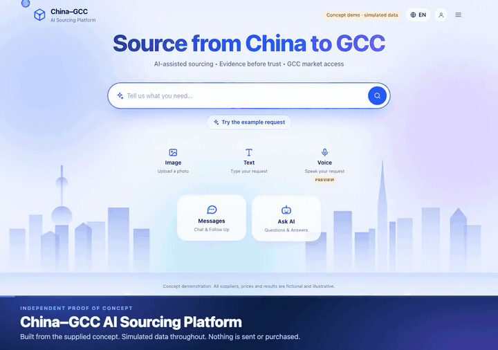
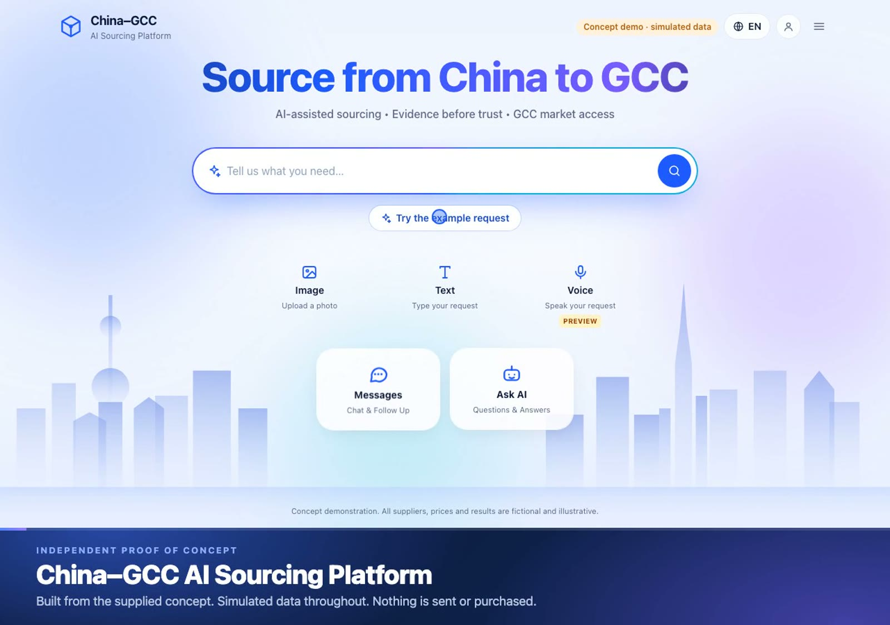

<div align="center">

# China–GCC AI Sourcing Platform

**Evidence-first supplier sourcing, from a typed request to an RFQ draft.**




**[Case study on the portfolio →](https://shahzeb-naeem.vercel.app/en/work/china-gcc-sourcing)** &nbsp;·&nbsp; **[Full walkthrough film →](assets/walkthrough.mp4)**

</div>

> Built by [Shahzeb Naeem](https://github.com/snaeemm). This is a concept demo: no backend, no network calls, no authentication, and every supplier, price and result is **fictional and illustrative**.

## Why it is built this way
- **Evidence over confidence.** Every supplier card shows its verification status and what is still unverified. The recommendation explains cost, exclusions and pending checks instead of just ranking.
- **Nothing commits without approval.** Sample and RFQ actions are previews, with a consent gate between a draft and anything being sent.
- **Say what is simulated.** Understanding is a regex parser, not a model. Voice and image analysis are marked Preview.



## Run
```bash
npm install
npm run dev        # open the URL it prints (usually http://localhost:5173)
npm run typecheck  # TypeScript check
npm run build      # production build into dist/
```
Requires Node 20+.

## Genuinely implemented
- Three connected screens, stepper navigation, English/Arabic toggle with RTL layout
- Rule-based extraction of quantity, thickness, length, colour and destination from typed text (editable fields)
- Real local image picker with thumbnail (the file never leaves the browser)
- Match status computed from fixed supplier attributes vs. the (editable) request
- Supplier selection, side-by-side cost comparison, sample-request preview modal with consent gate

## Simulated
- "Understanding" is a regex parser, not an AI model; no model calls anywhere
- Suppliers A/B/C, prices, freight and production times (from the concept PDFs); matching is deterministic
- Image analysis, voice input (labelled **Preview**), Messages and Ask AI (static sample content)
- Sample request: saves a draft preview only. Nothing is sent, ordered or paid.
- Cost figures are for the 500 m² example only; inspection, duties, taxes and final delivery are shown as excluded.

## 60–90 second walkthrough
1. (10s) Homepage: one search bar; Messages and Ask AI as secondary. Click **Try the example request**.
2. (15s) Specs extracted: 500 m², 8 mm, 2.8 m, light wood, Dubai. Click **Find matching suppliers**.
3. (25s) Three fictional suppliers: A matches but colour needs a sample; B is 6 mm; C's MOQ exceeds 500 m². Note "Factory not verified" on each. Keep A + B selected, **Compare selected**.
4. (25s) Recommendation: A costs AED 1,800 more (24,000 vs 22,200 goods + freight) but keeps 8 mm. Point to exclusions, pending checks and evidence panel.
5. (15s) **Request Sample** → review preview, tick consent, save draft: nothing is sent. Optionally flip to Arabic.

## Not included (separate scoped work)
Architecture and agent/data-flow diagrams, technology stack, database schema and vector indexing, role-based access model and approval matrix, evaluation plan, MVP work breakdown and estimate. The three extra screens are layouts with fictional data, not working workflows.

## Needs a paid production engagement
Real supplier/product database and ingestion; factory verification and document checks; image, voice and LLM understanding; RFQ and real quotations; landed-cost engine (freight, duties, VAT, fees); authentication, roles and audit log; reviewer dashboard and decision memory; Messages/WhatsApp/email integrations; approval workflow and payments; security, privacy and compliance review; production hosting and monitoring.
